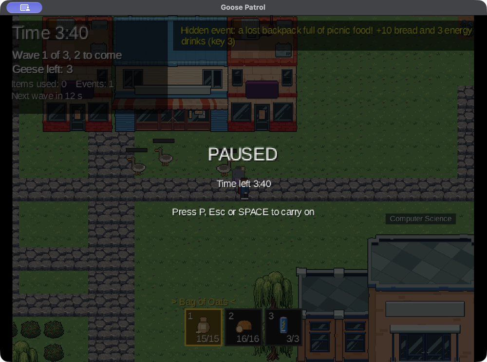
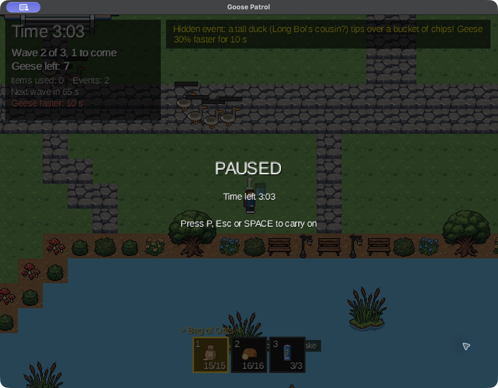

# Platform tests of the released JAR

Checks QR_PLATFORM ("runs on Windows, macOS and Linux") and QR_STABLE (a whole game with no crash).
Results go into Impl1 (features table) and Risk1 (R18). Each test names the exact JAR it used, because
the JAR on the website is rebuilt whenever `main` changes.

| Test | Date | JAR (SHA-256, size) | Systems |
|---|---|---|---|
| 1 | 9 Nov 2026 | `f4b96d50…a7` (17,446,020 bytes), before the message fix | macOS, Ubuntu (VM), Windows 11 (VM) |
| 2 | 9 Nov 2026 | `86a86daf…ed` (17,446,163 bytes), after the message fix (PR #51) | macOS only |
| 3 | 9 Nov 2026 | The game as on `main` after PR #51 (the same code as test 2) | A real Windows PC |

Full hashes: test 1 `f4b96d5013d54a43a2b080f51beae3c1335730e9b377c6b4c7fe6e44212310a7`,
test 2 `86a86dafe61143992b2545aa7830aadf42005a53e97837fcce8116d2a82a88ed`.
In both tests the JAR was downloaded from the team website and not changed.

## How the games were run

- **`java -jar`** was run on every system, and its console output was saved.
- **On macOS, the games that were watched and played** ran through a temporary launcher made with
  `jpackage`. It starts the same, unchanged JAR with Java 17 and `-XstartOnFirstThread`, so that the
  tester's screen tools could control the window. This is not the same as double-clicking the JAR, so
  double-clicking on macOS is counted as not verified.
- **On Ubuntu and Windows** the JAR was started with a portable Java 17, using `java -jar`.

## Test 1: three systems

| | macOS | Linux | Windows |
|---|---|---|---|
| System | macOS 27.2, Apple silicon (ARM64), real machine | Ubuntu 26.04.1 LTS, ARM64, virtual machine (UTM) | Windows 11, ARM64, virtual machine (UTM), x64 Java under emulation |
| Java | Temurin 17.0.20.1 | Temurin 17.0.21 (portable) | Temurin 17.0.21 x64 (portable) |
| `java -jar` | Starts; the console showed only the map loading line | Start screen opened | **No window.** WGL reported "The driver does not appear to support OpenGL", then `Couldn't create window` |
| Double-click | Java started; the result was not checked | Opened the file manager instead (no `.jar` link for a portable Java) | Windows asked which app to use (no `.jar` link for a portable Java) |
| Whole game | 5:00 to 0:00, "Time's up" screen, no crash (through the launcher) | Won with 0:06 left (4 min 54 s played, 8 items, 2 events), no crash | Not possible |
| Restart with R | Back to 5:00, counters and items reset | Same | Not possible |
| Controls | WASD, arrows, 1/2, click, P, Esc, M, T all worked | Same | Not possible |
| Walls | Player stops at walls | Player stops at walls and at a crowd of geese | Not possible |
| Hidden events | Both found (backpack and duck) | Both found | Not possible |
| Honk warning | Red goose, HONK!, slow-down shown | Same | Not possible |
| Sound | M switches the "Sound off" text on and off. The computer was reported as muted, so no sound was heard; this does not show whether sound plays | No sound was heard; not checked further | Not possible |
| Console | No exception in the `java -jar` run; the launcher run was not logged | No exception; warnings from the virtual machine's graphics (libdecor, Mesa) | `Couldn't create window` |

## Test 2: macOS again, after the message fix

| Check | Result |
|---|---|
| System and Java | The same Mac and Java as in test 1 |
| Both hidden events | Found by walking to them; the message sits to the right of the status panel and wraps onto two lines |
| Window sizes | Normal (960 x 720) and the smallest the window allows (900 x 640): the message covers neither the timer nor the panel |
| Whole game | 5:00 to 0:00, "Time's up" screen; no crash; the launcher's whole console output was saved and has no exception |
| Restart with R | Back to 5:00 with counters and items reset |
| Not repeated | Linux and Windows (their virtual machines were off), double-click, every key |

After the fix, at the smallest window size (test 2, paused so the message could be captured):

## Test 3: a real Windows PC

A team member played the game on their own Windows PC on the evening of 9 Nov and reported that it
worked well. Unlike tests 1 and 2, no log, screenshot, Windows or Java version was recorded, and it is
not recorded whether a whole 5-minute game was played. This answers the main open question from
test 1: the game opens and runs on a real Windows PC, so the virtual machine's failure was a limit of
that machine. To record next time: `java -version`, the Windows version, the JAR's SHA-256, and a
screenshot of the result screen.

## Problems found and what we did

1. **Messages ran over the status panel** (test 1, macOS and Linux). The yellow message box was centred,
   so a long message covered the timer and the panel on the left.
   **Fixed in PR #51:** the box starts to the right of the panel and wraps. Checked in test 2.

   Before (test 1):
   

2. **An event message could be replaced before it was read** (test 2). A goose snatch 2 seconds after
   the duck event replaced the duck's message. **Fixed after test 2:** an event message now stays for
   at least 4 seconds; a message that arrives meanwhile is shown after it (`Messages`, `MessagesTest`).
   Checked by unit tests; not yet checked in a played game.
3. **No window in the Windows virtual machine.** libGDX needs OpenGL, and this virtual machine's driver
   reported that it did not support it. A team member then played the game on a real Windows PC
   (test 3), so this was a limit of the virtual machine, not of the game.
4. **Double-click did nothing with a portable Java**, which does not link `.jar` files to itself. The
   website now says to try double-clicking and, if that does not work, to run `java -jar` in a terminal.
5. **The Linux window had no title bar** in the virtual machine, so resizing could not be tried. The
   console shows that the desktop's decoration plug-in failed to load (`libdecor-gtk.so`). To try again
   on a real Linux PC.

## Not covered yet

- A recorded full game on Windows (test 3 has no log), a real Linux PC and an Intel Mac.
- The final build on all three systems.
- Hearing the sounds.
- Frame rate: no slowdowns were seen, but none were measured.
- First-time players: see [playtest.md](playtest.md).
