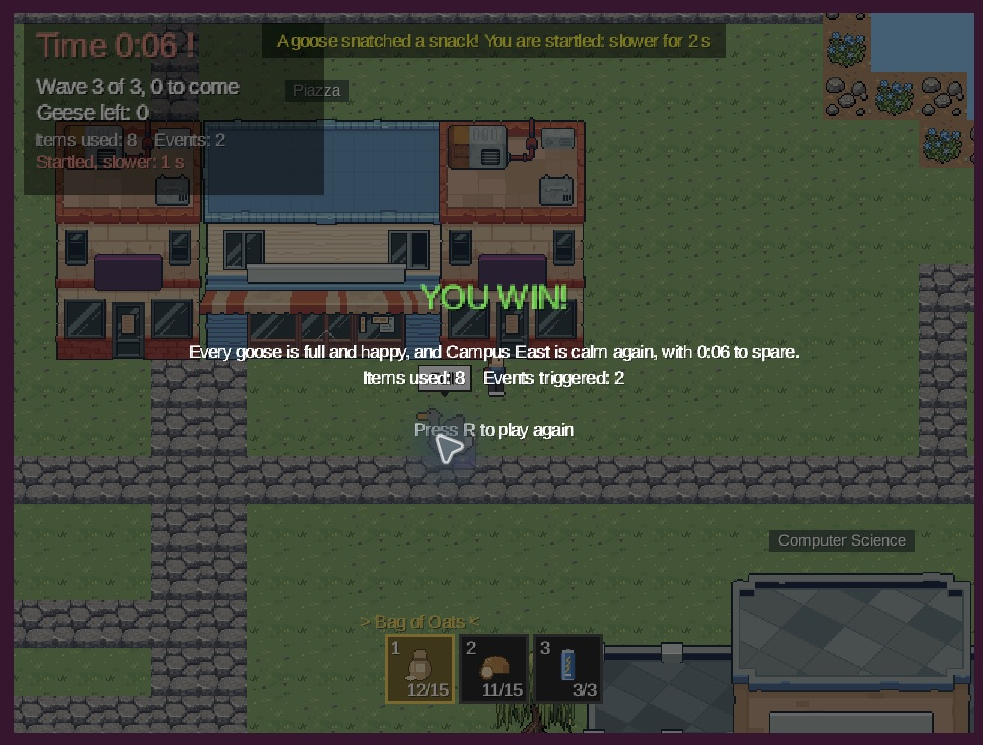
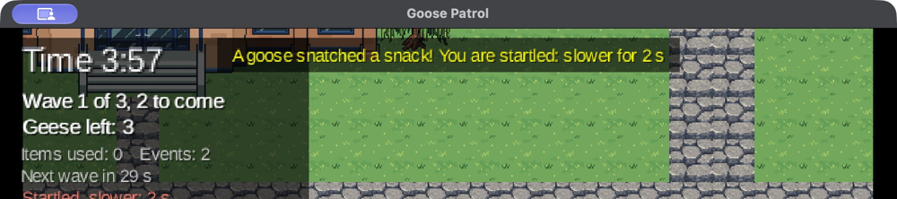

# Platform test of the released JAR

Checks QR_PLATFORM ("runs on Windows, macOS and Linux") and QR_STABLE (a whole game with no crash).
Results go into Impl1 (features table) and Risk1 (R18).

**Date:** 9 Nov 2026
**What was tested:** `GoosePatrol-1.0.0.jar` downloaded from the team website (17,446,020 bytes,
SHA-256 `f4b96d5013d54a43a2b080f51beae3c1335730e9b377c6b4c7fe6e44212310a7`, the same on all three
machines). The JAR was not rebuilt or changed for the test.

## Results

| | macOS | Linux | Windows |
|---|---|---|---|
| System | macOS 27.2, Apple silicon (ARM64), real machine | Ubuntu 26.04.1 LTS, ARM64, virtual machine (UTM) | Windows 11, ARM64, virtual machine (UTM), x64 Java under emulation |
| Java | Temurin 17.0.20.1 | Temurin 17.0.21 (portable) | Temurin 17.0.21 x64 (portable) |
| `java -jar` | Starts | Starts | **No window:** "WGL: The driver does not appear to support OpenGL" |
| Double-click | Java started; the result was not checked | Opened the file manager instead (no `.jar` link for a portable Java) | Windows asked which app to use (no `.jar` link for a portable Java) |
| Whole game | 5:00 to 0:00, "Time's up" screen, no crash | Won with 0:06 left (8 items, 2 events), no crash | Not possible |
| Restart with R | Back to 5:00, counters and items reset | Same | Not possible |
| Controls | WASD, arrows, 1/2, click, P, Esc, M, T all worked | Same | Not possible |
| Walls | Player stops at walls | Player stops at walls and at a crowd of geese | Not possible |
| Hidden events | Both found (backpack and duck) | Both found | Not possible |
| Honk warning | Red goose, HONK!, slow-down shown | Same | Not possible |
| Sound | M toggles the sound icon; the computer was muted, so sound was not heard | Not heard (virtual machine) | Not possible |
| Console | No exception | No exception; warnings from the virtual machine's graphics (libdecor, Mesa) | `Couldn't create window` |

## Problems found and what we did

1. **An event message covered the timer and status panel** (macOS and Linux). The yellow message box
   was centred on the screen, so a long message ran into the panel on the left.
   **Fixed:** the box now starts to the right of the status panel and wraps long text onto a
   second line. Checked at the smallest window size (900 x 640).

   Before:
   

   After (longest message, smallest window):
   

2. **No window in the Windows virtual machine.** The virtual machine has no OpenGL driver, and
   libGDX needs OpenGL. This is a limit of the test machine, not of the game, but it means Windows
   is **not yet verified**. Next step: run the same JAR on a real Windows PC (see R18 in Risk1).
3. **Double-click did nothing with a portable Java.** A portable Java does not link `.jar` files to
   itself. The website now says to use `java -jar GoosePatrol-1.0.0.jar` when double-clicking does
   not work, and links to a Java 17 installer.
4. **Linux window had no title bar** in the virtual machine, so resizing could not be tried. The
   console shows the desktop's decoration plug-in failed to load (`libdecor-gtk.so`). Not seen on
   macOS. To try again on a real Linux PC.

## Not covered yet

- A real Windows PC (x64), a real Linux PC and an Intel Mac.
- Hearing the sounds.
- Frame rate; no slowdowns were seen but none were measured.
- First-time players: see [playtest.md](playtest.md).
